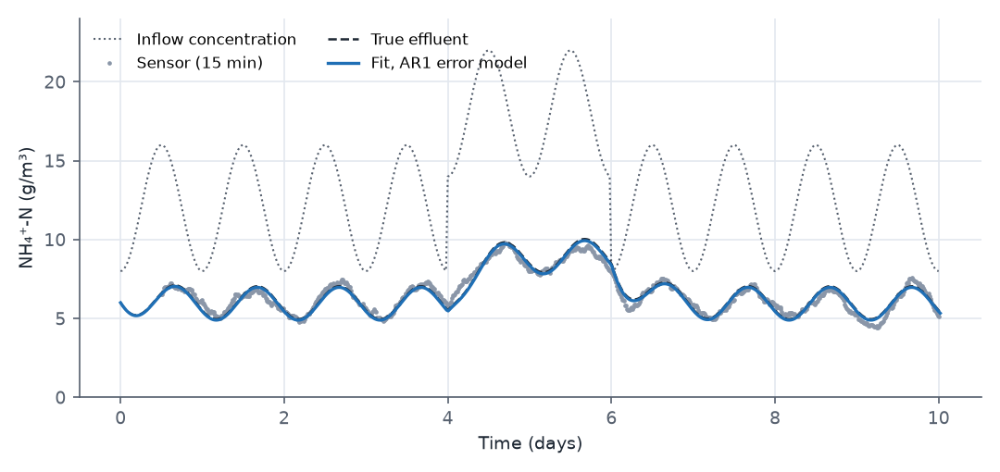
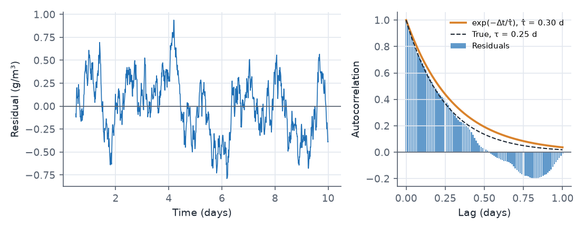
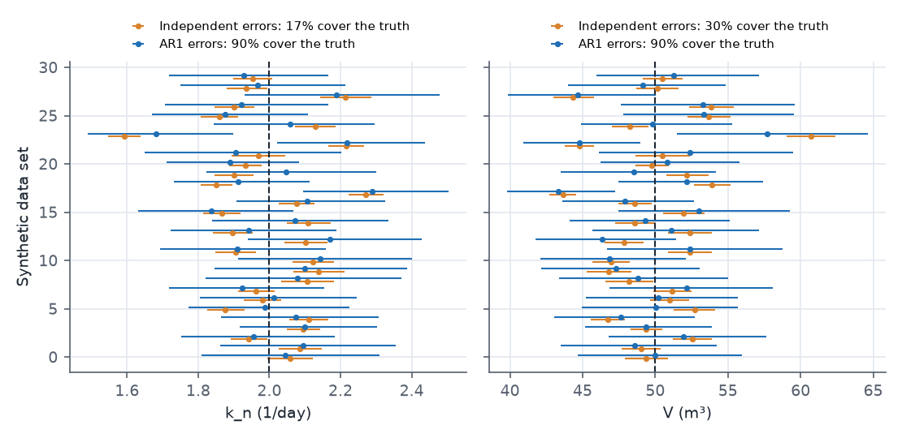

## What this model represents

Online sensors record water quality every few minutes. A model fitted to such a record has residuals that are strongly **serially correlated**: an error in timing, a sensor drift or a missing process keeps the residual on the same side of zero for hours. The standard least-squares likelihood treats each of the n residuals as independent information. With a correlated record, the effective number of independent residuals is much smaller than n, so the reported parameter uncertainty is too small, often by a large factor, and confidence intervals routinely miss the true values.

OpenHydroQual 2.1.1 adds an optional **continuous-time first-order autoregressive (AR1) error model** to every Observation. This example shows what it does on a case where the answer is known. A small treatment basin removes ammonium by nitrification; its volume and rate constant are calibrated from a synthetic 15-minute effluent record whose errors were generated with a known AR1 process. The same data are fitted twice with Levenberg-Marquardt (LM): once assuming independent errors (`basin_iid.ohq`) and once with the AR1 model (`basin_ar1.ohq`). A study of 30 independent noise realizations then checks how often each method's 95% intervals contain the truth.

## How it works

### The basin

The basin is a Reactor block with a constant inflow Q = 100 m³/day and a Fixed flow link that removes 100 m³/day, so its volume V stays at its initial value. Ammonium enters at the time-varying concentration C_in(t) and is removed by the reaction `Nitrification` (rate k_n·C, coefficient −1):

  V·dC/dt = Q·(C_in(t) − C) − V·k_n·C

At steady state C = C_in/(1 + k_n·V/Q), so the effluent level fixes the product k_n·V. The diurnal swing in C_in passes through the basin with an amplitude reduced by roughly (Q/V)/√((Q/V + k_n)² + ω²), with ω = 2π per day, which depends on Q/V + k_n. Together the level and the swing identify k_n and V, but the two remain strongly negatively correlated. The 2-day step in C_in adds information on the response time. V is calibrated through `setasparameter` on the block's `Storage`, which sets the initial (and here constant) volume.

### The error models

For an observation with residuals eᵢ = oᵢ − mᵢ at times tᵢ, the default (`error_autocorrelation = none`) likelihood is

  −ln L = n·ln σ + Σ eᵢ²/(2σ²)

With `error_autocorrelation = AR1` the residuals are modelled as a continuous-time AR1 (Ornstein-Uhlenbeck) process with correlation time τ (`error_correlation_time`, days):

  eᵢ = φᵢ·eᵢ₋₁ + ηᵢ,  φᵢ = exp(−(tᵢ − tᵢ₋₁)/τ),  ηᵢ ~ N(0, σ²(1 − φᵢ²)),  e₁ ~ N(0, σ²)

so σ (`error_standard_deviation`) keeps its meaning as the standard deviation of a single residual, and the correlation between two residuals Δt apart is exp(−Δt/τ). Because φᵢ is computed from the actual spacing, irregular sampling and gaps are handled: across a gap much longer than τ, φ → 0 and the error process restarts. The exact negative log-likelihood is

  −ln L = n·ln σ + Σᵢ≥₂ ln √(1 − φᵢ²) + [u₁² + Σᵢ≥₂ uᵢ²]/(2σ²),  u₁ = e₁,  uᵢ = (eᵢ − φᵢ·eᵢ₋₁)/√(1 − φᵢ²)

that is, the independent-error likelihood applied to the **whitened** residuals uᵢ, plus a log-determinant term that depends only on τ and the observation times. φ is capped at 0.9999, and τ = 0 reproduces the independent model exactly. The AR1 model is implemented for the `Least Squared` comparison and should not be combined with `likelihood_scale` > 1, which corrects for the same autocorrelation in a cruder way. The same likelihood is used by the genetic algorithm, MCMC and LM.

### What LM does with σ and τ

Here σ and τ are both calibrated parameters (`p_sigma`, `p_tau`), but LM does not search for them with the kinetic parameters. After every accepted step it sets τ by a golden-section search over its range (in log10 space), evaluating the likelihood from the stored raw residuals with no model run, and at each trial τ it sets σ to its best value, the root-mean-square of the whitened residuals. The Jacobian is formed from the whitened residuals divided by σ, so the covariance (JᵀJ)⁻¹ that LM reports for k_n and V is the generalized least-squares covariance for correlated errors. It is conditional on the profiled σ and τ.

### Running

```
OHQ-LM basin_ar1.ohq ./ --threads 2
OHQ-LM basin_iid.ohq ./ --threads 2
OHQ-LM basin_ar1.ohq ./ --verify-residuals
```

Relative file names are resolved against the output folder given on the command line, so run LM with the model's own folder as the output folder (`./`), or copy the input files there. `--verify-residuals` reports the AR1 log-determinant term separately and confirms that ½‖r‖² + n ln σ + Σ ln √(1 − φᵢ²) equals the misfit. In the interface, press **Levenberg-Marquardt calibration**. The AR1 model needs OpenHydroQual 2.1.1 or later: an older build ignores `error_autocorrelation` and fits independent errors. The results below were produced with `OHQ-LM` built from the 2.1.1 sources, two threads; each fit takes 19 to 37 model runs and a few seconds.

## What to look for in the results



Both error models fit the curve almost identically; the difference is in what they say about its uncertainty.

| | Independent errors | AR1 errors | Truth |
|---|---|---|---|
| k_n (1/day), 95% interval | 2.057 (1.995 to 2.122) | 2.045 (1.810 to 2.310) | 2.0 |
| V (m³), 95% interval | 49.4 (47.9 to 50.9) | 50.0 (44.7 to 56.0) | 50 |
| correlation of k_n and V | −0.98 | −0.93 | |
| σ (g/m³), profiled | 0.318 | 0.317 | 0.3 |
| τ (days), profiled | (not modelled) | 0.30 | 0.25 |
| −ln L at the optimum | −588.3 | −1827.6 | |

- **Same fit, very different intervals.** The independent model's interval for k_n is ±3%, and only just contains the true value; for many of the replicate data sets below it does not. The AR1 interval is about four times wider. The point estimates hardly move, because the curve is the same; what changes is how much information 913 correlated points are credited with.
- **The likelihood strongly prefers AR1.** −ln L falls by 1239 when the single extra parameter τ is added, an overwhelming improvement for one parameter. The estimated τ = 0.30 day is close to the 0.25 day used to make the noise.



- **Reading the residuals.** Consecutive residuals 15 minutes apart have a correlation of 0.97, and the sample autocorrelation falls to 1/e at a lag of about 0.27 day, as the fitted exp(−Δt/τ̂) predicts. Over long lags the sample autocorrelation of a finite record dips below zero; that is a known bias of the estimator, not a property of the errors. A plot like this, made from the residuals of an independent-error fit, is the quickest way to decide whether the AR1 model is needed.



| Over 30 data sets | Independent errors | AR1 errors |
|---|---|---|
| intervals containing the true k_n | 5 of 30 (17%) | 27 of 30 (90%) |
| intervals containing the true V | 9 of 30 (30%) | 27 of 30 (90%) |
| reported SE of log10 k_n (mean) | 0.006 | 0.025 |
| actual spread of log10 k_n (SD over data sets) | 0.032 | 0.028 |
| mean τ̂ (days) | | 0.245 (truth 0.25) |

- **Honest uncertainty.** The actual scatter of the estimates from data set to data set is about the same for both methods (both are unbiased on average: mean k_n 2.005 and 2.015). But the independent model reports a standard error five times smaller than that scatter, so its nominal 95% intervals cover the truth only 17 to 30% of the time. The AR1 standard error matches the scatter, and its intervals cover the truth in 27 of 30 cases, consistent with 95% given only 30 trials.
- **Why the factor is so large.** With samples 15 minutes apart and τ = 0.25 day, φ = 0.959 between neighbours. For a pure AR1 process the effective number of independent values is about n·(1 − φ)/(1 + φ) ≈ 19, not 913.

## Assumptions and limitations

- The noise was generated with exactly the error model that is fitted, which is the best case for AR1. Real residuals can have several time scales or heavy tails; check the residual autocorrelation after fitting.
- The AR1 process is stationary with constant σ. Errors that grow with the concentration need a transformation (for example `error_structure = log-normal`, for which the AR1 model applies to the log residuals).
- LM's covariance for k_n and V is conditional on the profiled σ and τ and assumes the likelihood is close to quadratic near the optimum. For a full posterior including σ and τ, run MCMC on the same file with p_sigma and p_tau as sampled parameters.
- These results were produced with LM only. The genetic algorithm and MCMC evaluate the same AR1 likelihood, but were not run for this example.
- The settings are kept small (one record of 10 days, 30 replicates). The replicate study is not part of the download; it reruns the two files on new noise realizations.
