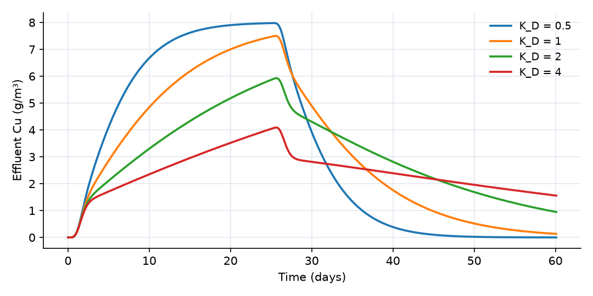

## What this model represents

Every OpenHydroQual model is saved as a plain-text `.ohq` file, and that file is a **script**: each line is a command that the program executes in order to build the model. The same file can be opened in the graphical interface or run without it by the console solver `OpenHydroQual-Console`. Because the format is text, any language can write, edit and run models. This is how batch runs, parameter sweeps, scenario studies and post-processing are automated.

The example has three parts:

1. `column.ohq`, a 1 m soil column through which a 25-day copper pulse passes, with kinetic sorption (the same column as the genetic algorithm example, which documents its physics in detail).
2. A reference for the script commands, taken from the parser in the OpenHydroQual source (`aquifolium/src/Command.cpp` and `Script.cpp`).
3. `sweep.py`, a Python script that runs the column for four values of the distribution coefficient K_D and plots the effluent curves.

The column is adapted from a script-built column model in the OpenHydroQual example collection (`Script.ohq`), rebuilt at 1 m² cross-section with ten cells.

## How it works

### The script language

A command line has the form

```
keyword [argument]; property=value, property=value, ...
```

The text before the first `;` is the keyword and, for `create` and `write`, one argument. Everything after it is a list of `property=value` pairs separated by commas. The parser splits on `;`, `,` and `=` without regard to brackets, so a value cannot contain any of those three characters. Write keywords in lower case. Lines are executed in order, so an object must be created before a later line refers to it.

| Command | Required properties | What it does |
|---|---|---|
| `loadtemplate; filename=main_components.json` | filename | Clears the model and loads the main template (the definitions of every object type and property). A bare file name is looked up in the resources folder. |
| `addtemplate; filename=<plugin>.json` | filename | Adds a plugin's object types, for example `groundwater.json` or `mass_transfer.json`. |
| `create block; type=..., name=..., ...` | name, type | Creates a block and sets the listed properties. |
| `create link; type=..., name=..., from=..., to=..., ...` | name, type, from, to | Creates a link from one block to another. If the name is taken, the link is renamed. |
| `create source; type=..., name=...` | name, type | Creates a source (rainfall, evaporation, loads), which blocks then refer to by name. |
| `create constituent; type=..., name=...` | name | Creates a constituent; it becomes a property set (`Cu_aq:concentration`, ...) on every block and link. |
| `create reaction_parameter; type=..., name=...` | name | Creates a named coefficient for rate expressions. |
| `create reaction; type=Reaction, name=..., rate_expression=..., <constituent>:stoichiometric_constant=...` | name | Creates a reaction. |
| `create composite; type=..., name=...` | name, type | Creates a composite block (a pre-assembled group). |
| `create observation; type=Observation, name=..., object=..., expression=...` | name, object, expression | Records an expression evaluated on a block or link, and compares it with `observed_data` if given. |
| `create parameter; type=Parameter, name=..., low=..., high=..., value=...` | name, low, high | Creates a calibration parameter. |
| `create objectivefunction; name=..., object=..., expression=...` | name, object, expression | Creates an objective function for optimization. |
| `setasparameter; object=..., quantity=..., parametername=...` | all three | Binds a model property to a calibration parameter. |
| `setvalue; object=..., quantity=..., value=...` | all three | Sets one property. `object=system` addresses the settings (simulation times, solver, GA, MCMC); `object=LM` the Levenberg-Marquardt settings; any other name is looked up among blocks, links, sources, constituents, reaction parameters, reactions, observations, parameters and objective functions. |
| `echo; object=...[, quantity=...]` | object | Prints the object, or one of its properties, to the console. |
| `write outputs; filename=...` / `write errors; filename=...` | filename | Writes the current results or the error list. |
| `solve`, `optimize` | | Run the model or the genetic algorithm at that point in the script. |

Every `type` must be defined in a loaded template, otherwise the line fails with "Type ... does not exist". Values may carry a unit in brackets, as the interface writes them (`Storage=10[m~^3]`); in the files tested for these examples the number was used as written, without unit conversion, so give numbers in the model's base units (m, m³, days, g/m³). The models on this site use only `loadtemplate`, `addtemplate`, `create`, `setvalue` and `setasparameter`. `solve` and `optimize` are not needed in a file meant for the console, which builds the model and then solves it once by itself.

`column.ohq` contains, in this order: the two template lines, the two constituents, four reaction parameters, two reactions, eleven blocks, ten links and the settings. Its system settings include `max_timestep_increase_factor = 1`, which holds the step at 0.05 day. With the default the step grows to 2.5 days, and the implicit time stepping then smooths the effluent curve: late in the tail the computed concentration is up to 15% higher.

### The console solver

```
OpenHydroQual-Console column.ohq -r /path/to/OpenHydroQual/resources -q -o output.txt
```

| Option | Meaning |
|---|---|
| `-r`, `--resources <dir>` | Folder with the template files. Default: `$OHQ_RESOURCES`, then a path relative to the executable. |
| `-o`, `--outputfile <name>` | Name of the results file, overriding the model's `alloutputfile`. |
| `-w`, `--workdir <dir>` | Folder against which relative input file names are resolved and outputs are written. Default: the folder of the `.ohq` file. |
| `-q`, `--quiet` | No per-step progress output. |
| `--skip-verify` | Skip the check of every property against the limits declared in the templates (not recommended). |

The console reads the script, stops with exit code 4 if any line failed (a missing input file, an unknown type or property) or if a property violates its declared limits, solves, and writes the results. If the model defines calibration parameters, their `value` fields are applied before the run. Observations with observed data are scored and their fit (MSE, R², NSE, −ln L) is printed. Messages logged while the model is solving are printed as warnings; the run continues and still exits 0. Exit codes: 0 success, 2 usage error, 3 model file not found, 4 model errors, 5 solve failed. A script should always check the exit code.

The results file has one pair of columns per output, `t, Cell_10_Cu_aq:concentration, t, Cell_10_Cu_s:concentration, ...`: a block or link property is named `<object>_<property>`, a constituent property `<object>_<constituent>:<property>`. All series are resampled to a common time grid.

### The Python script

`sweep.py` uses only the standard library and matplotlib. It never edits the original files. For each value it:

1. creates a folder `runs/K_D_<value>/` and copies `column.ohq`, `inflow.txt` and `inflow_concentration.txt` into it;
2. appends one line to the copy, `setvalue; object=K_D, quantity=base_value, value=<value>`. Because commands run in order, this overrides the value set by the earlier `create reaction_parameter` line;
3. runs `OpenHydroQual-Console <copy> -q -o output.txt` with `subprocess` and stops with a message if the exit code is not 0;
4. reads `output.txt` and extracts the requested column.

```
python3 sweep.py --console /path/to/OpenHydroQual-Console --resources /path/to/OpenHydroQual/resources
python3 sweep.py --object k_f --quantity base_value --values 0.1 1 10      # vary another property
python3 sweep.py --series Cell_05_Cu_aq:concentration                      # plot another output
```

The options `--object`, `--quantity` and `--values` choose what is varied, so the same script sweeps any property of any named object: a block's `area`, a link's `flow`, a constituent's `dispersivity`. The solver's messages for each run are kept in `console.log` in its run folder. The script also writes `sweep_summary.csv` with the time at which the effluent first reaches half the inflow concentration and the peak concentration of each run.

Running the solver as a separate process keeps the Python side simple and lets independent runs execute in parallel (for example with `concurrent.futures.ProcessPoolExecutor`). The OpenHydroQual source also contains Python bindings (`PythonBindings/`, built with pybind11 against the OpenHydroQual library) that create blocks and links, set values, solve and save models from within Python. They are not part of the binary distribution and must be compiled with Qt and Armadillo; this example does not use them.

## What to look for in the results



| K_D (L/kg) | Retardation factor R = 1 + ρ_b·K_D/n | Equilibrium front arrival R × 2 days | Effluent first reaches 4 g/m³ | Peak (g/m³) |
|---:|---:|---:|---:|---:|
| 0.5 | 3 | 6 days | 4.9 days | 7.98 |
| 1 | 5 | 10 days | 7.7 days | 7.50 |
| 2 | 9 | 18 days | 13.3 days | 5.93 |
| 4 | 17 | 34 days | 24.6 days | 4.09 |

The four runs took about 15 s in total.

- **Retardation.** The arrival time grows with K_D, because sorbed copper must be supplied before the front can advance. For instantaneous (equilibrium) sorption the centre of the front would arrive after R pore volumes, R × 2 days.
- **Kinetic sorption shortens it.** With k_f = 1 1/day sorption is not instantaneous, so every run shows an early rise within the first pore volume (about 2 days), and half the inflow concentration is reached before the equilibrium arrival time. The stronger the sorption, the larger the difference: for K_D = 4 L/kg the effluent reaches 4 g/m³ ten days early, and the 25-day pulse never brings it near 8 g/m³.
- **Tails.** After day 25, strongly sorbing soils release copper slowly. At day 60 the effluent is still 1.6 g/m³ for K_D = 4 L/kg but nearly zero for K_D = 0.5 L/kg. The order of the curves reverses: the soil that retained the most copper during the pulse releases the most afterwards.

## Assumptions and limitations

- The physics is that of the genetic algorithm example: steady saturated flow, linear kinetic sorption with one site type, and numerical dispersion from ten mixed cells.
- The sweep changes one property at a time. Appending several `setvalue` lines per run, or generating them from a table, extends it to multi-parameter designs; each run is independent.
- `sweep.py` assumes the console writes a complete results file. A run that fails stops the sweep, with the console's messages in that run's `console.log`.
- The Levenberg-Marquardt documentation describes an `lmoptimize` script command. In the console build used here, a line `lmoptimize` is rejected with "Keyword 'lmoptimize' is not recognized"; use the `OHQ-LM` program for headless LM calibration.
