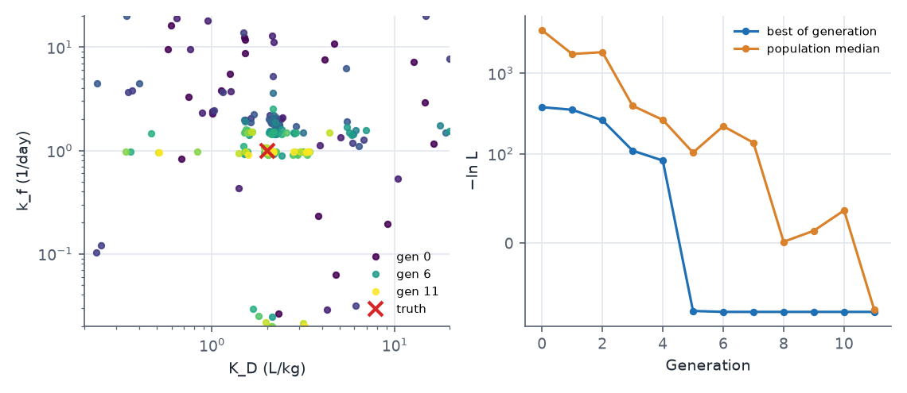
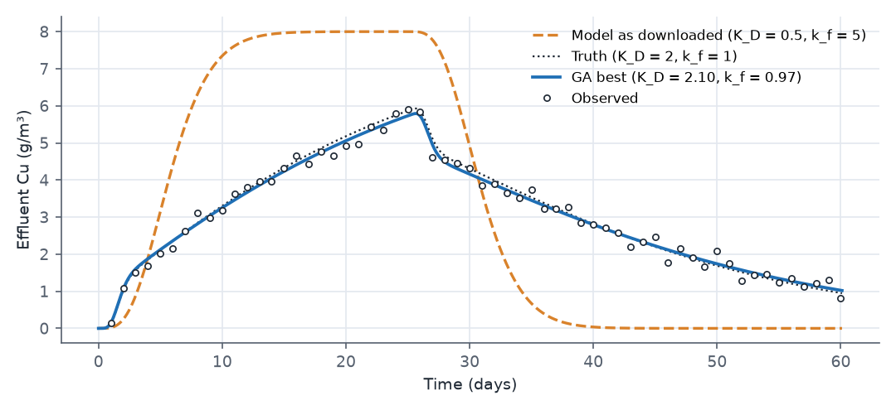

## What this model represents

Column and lysimeter experiments are the standard way to measure how strongly a soil retains a contaminant. A solution of known concentration is fed through a packed column, the effluent concentration is measured over time, and the shape of the breakthrough curve is interpreted with a transport model. Here a 25-day pulse of 8 g/m³ copper passes through a 1 m column of soil. Copper sorbs to the soil with finite speed (kinetic sorption), so the breakthrough curve carries two pieces of information: how strongly copper is held (the distribution coefficient K_D) and how fast it reaches equilibrium (the rate constant k_f).

Both parameters are estimated with OpenHydroQual's **genetic algorithm (GA)**, the method behind **Inverse Run**. Unlike gradient methods, the GA needs no starting guess: it samples the full range of each parameter, which is useful when the plausible range spans orders of magnitude, as it does here (K_D from 0.2 to 20 L/kg, k_f from 0.02 to 20 1/day). The data are synthetic, made with the same model at K_D = 2 L/kg and k_f = 1 1/day, so the result can be checked.

The model is adapted from a laboratory column study in the OpenHydroQual example collection. It was rebuilt at lysimeter scale (1 m² cross-section) with ten cells; see the limitations section for why.

## How it works

### Transport

The column is a chain of ten Groundwater cells, each 0.1 m thick, connected by Fixed flow links carrying Q = 0.2 m³/day. With 0.04 m³ of pore water per cell, the pore volume is 0.4 m³ and the water residence time is 2 days (pore velocity 0.5 m/day). Each cell is fully mixed, so the column behaves as ten tanks in series; the numerical dispersion this produces is equivalent to a dispersivity of about half a cell, 0.05 m. Dissolved copper is carried by upstream advection: the mass flux in each link is Q times the concentration in the upstream cell.

### Sorption

Two reactions exchange copper between the water and the soil:

| Reaction | Rate | ν for Cu_aq | ν for Cu_s |
|---|---|---|---|
| Adsorption | k_f·Cu_aq | −1 | +n/ρ_b |
| Desorption | (k_f/K_D)·Cu_s | +1 | −n/ρ_b |

with n = 0.4 and ρ_b = 1.6 kg/L. OpenHydroQual multiplies each rate by the cell's water volume, so in each cell

  dCu_aq/dt = (advection) − k_f·(Cu_aq − Cu_s/K_D)
  dCu_s/dt = (n/ρ_b)·k_f·(Cu_aq − Cu_s/K_D)

The factor n/ρ_b converts a change in dissolved concentration (mg/L) into a change in sorbed content per mass of soil (mg/kg), so mass is conserved. At equilibrium Cu_s = K_D·Cu_aq, and the copper front is retarded by the factor R = 1 + ρ_b·K_D/n = 1 + 4·K_D, which is 9 at the true K_D: the centre of the front needs about 18 days to cross the column. Because sorption is not instantaneous, part of the copper passes the column within the first pore volume before it can sorb, which produces the early step in the breakthrough curve. The height of that step is set mainly by k_f, the timing and length of the rise and of the elution tail mainly by K_D.

### What the genetic algorithm computes

The GA minimizes the same negative log-likelihood that Levenberg-Marquardt and MCMC use. For the effluent observation, with n = 60 data points and σ = 0.2 g/m³:

  −ln L = n·[ MSE/(2σ²) + ln σ ],  MSE = (1/n) Σ (oᵢ − mᵢ)²

One generation works as follows (from the OpenHydroQual source, `GA.hpp`):

1. **Initial population.** `maxpop` = 20 parameter sets are drawn uniformly over each parameter's range, in log10 space for parameters with a `log-normal` prior. Each parameter is binary-coded.
2. **Evaluation.** The model is run for every individual (in parallel, `numthreads` = 2) and −ln L is computed. A failed or timed-out run (`maximum_time_allowed` = 120 s) scores 10¹⁸.
3. **Selection.** Individuals are ranked by −ln L; each receives the selection weight 1/rank, and parents are drawn with probability proportional to that weight.
4. **Elitism.** The best individual is copied unchanged into the first two places of the next generation.
5. **Crossover and mutation.** Each remaining pair of parents is combined with probability `pcross` = 1 by exchanging segments of their binary strings, and each bit of the offspring is flipped with probability `pmute` = 0.02.
6. **Shake.** Every individual except the first has each search-space coordinate multiplied by a random factor between 1 − s and 1 + s, with s = `shakescale` = 0.05. After generation 10, s is reduced by `shakescalered` = 0.75 whenever the best value has not changed for three generations.

After `ngen` = 12 generations the last population is evaluated once more and the best individual is written as the result. The GA reports the best parameter set and the full population history; it does not report parameter uncertainty.

### Running

In the interface, press **Inverse Run**: the best parameters are written back into the Parameter objects when it finishes. Headless:

```
OHQ-GA column_ga.ohq ./
```

Relative file names are resolved against the working folder given on the command line, so run it in the folder that contains the input files. It writes `GA_output.txt` (every individual of every generation with its −ln L, rank and fit measures), `detail_GA.txt` (start and end of every model run), and the outputs of a final run at the best parameters. The settings in the file are kept small so that the example finishes in about five minutes on two threads (260 model runs of about 2 s each). For a real calibration use a population of 40 or more and 30 to 50 generations (`maxpop`, `ngen`), as many threads as physical cores, and consider generating a compiled kernel with `ohq_generate` for a 10 to 15 times faster forward model.

## What to look for in the results



- **From scattered to concentrated.** Generation 0 covers the whole range of both parameters. By generation 5 the population has collapsed onto a band at k_f ≈ 1 1/day with K_D near 2 L/kg, and the best value has dropped from 378 to −76.
- **Convergence.** The best individual does not improve after generation 6. The population median keeps fluctuating because mutation and crossover keep producing poor individuals; that is how the GA keeps exploring. In the last generation the median also reaches about −75.
- **Mutations show the coding.** Points far below the band (k_f near 0.02) and at extreme K_D in late generations are mutants: one flipped high-order bit moves a parameter across a large part of its range.



| | Truth | GA best (generation 6) | LM started from the GA result |
|---|---:|---:|---|
| K_D (L/kg) | 2.0 | 2.099 | 2.096 (95%: 2.033 to 2.160) |
| k_f (1/day) | 1.0 | 0.975 | 0.982 (95%: 0.942 to 1.024) |
| −ln L | −71.9 | −76.68 | −76.75 |
| model runs | | 260 | 12 |

- **The shape of the curve.** The effluent jumps to about 1.5 g/m³ within the first 3 days (copper that passed before it could sorb), then rises slowly as the soil fills, and drops sharply when the pulse ends on day 25, followed by a long tail as sorbed copper is released. A model with equilibrium sorption would show none of the early step and a much shorter tail.
- **GA and LM together.** A Levenberg-Marquardt run started from the GA result (`OHQ-LM` on the same file after setting the parameter values to the GA estimates) converges in 3 iterations and adds what the GA cannot give: standard errors and the correlation between the parameters (−0.07, so the two are well separated by these data). This is the workflow the two methods are designed for: the GA finds the basin, LM converges inside it and quantifies the uncertainty.
- **The interval for K_D just misses the truth.** Both methods find a slightly better fit than the truth (−76.8 against −71.9), and the 95% interval for K_D (2.03 to 2.16) excludes the true value of 2. This happens for one data set in twenty by design; here the particular noise realization favours a slightly larger K_D. The error is 5%.

## Assumptions and limitations

- Water flow is steady and saturated, imposed by the Fixed flow links; the hydraulic properties of the Groundwater cells play no part.
- Sorption is linear and first-order kinetic with a single site type. Copper sorption in real soils is often nonlinear (Freundlich or Langmuir) and may involve fast and slow sites.
- Dispersion is represented only by the numerical mixing of ten cells (about 0.05 m dispersivity). A finer discretization, or a dispersivity on the constituent, would be needed to separate dispersion from kinetic effects in real data.
- The column is 1 m² in cross-section. The source model was a laboratory column (8 cm² × 0.5 m in 20 cells), whose cells hold only 8 cm³ of water. OpenHydroQual computes concentration as mass/(Storage + 10⁻⁵ m³), and for a cell that small the 10⁻⁵ m³ term is larger than the water volume, which distorts every concentration. The physics is scale-independent, so the example uses lysimeter dimensions.
- The solver step is held at its initial value of 0.05 day (`max_timestep_increase_factor = 1`). With the default growth factor the step reaches 2.5 days, and the implicit time stepping smooths the breakthrough curve by up to about 15%.
- The GA run is short. Its result depends on the random initial population; with 20 individuals and 12 generations a rerun can land on a slightly different point. Larger populations and more generations make the result reproducible.
