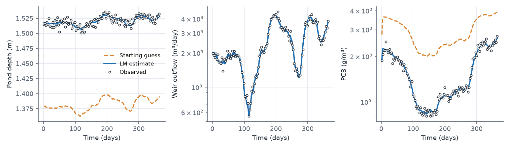
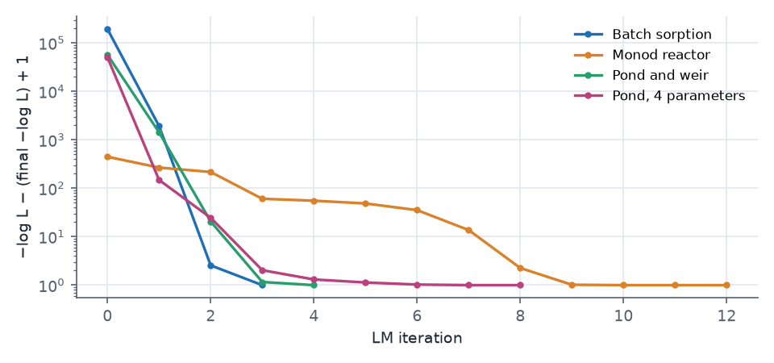
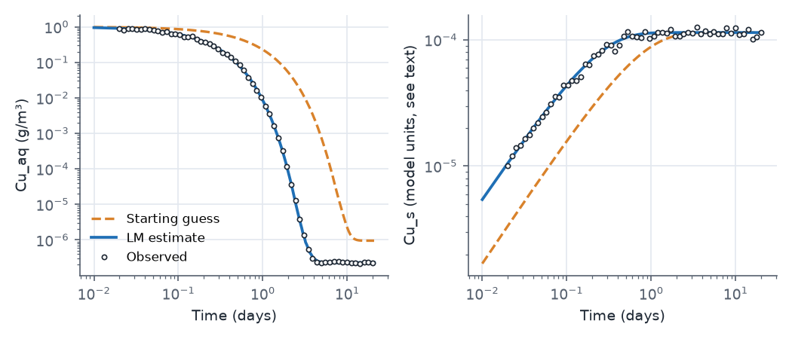
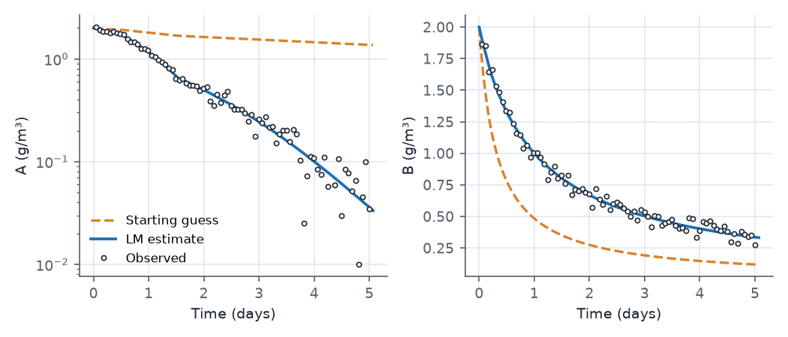

## What this model represents

Calibration means choosing parameter values so that a model reproduces measurements, and then saying how well those values are determined. This example contains three small calibration problems that are solved with OpenHydroQual's **Levenberg-Marquardt (LM)** optimizer. In each one the "observed" data were made by running the model at known parameter values and adding noise of a known size. Because the truth is known, each case can answer two questions that a real calibration never can: did the method recover the right values, and are the uncertainties it reports honest?

| Case | Files | Physics | Calibrated |
|---|---|---|---|
| 1 (main model) | `pond_calibration.ohq` | Pond water balance with a weir, first-order decay of a contaminant | weir α, crest elevation, k_d |
| 1b | `pond_calibration_4param.ohq` | Same, plus the pond's stage-storage coefficient | 4 parameters |
| 2 | `sorption_calibration.ohq` | Kinetic sorption of copper in a closed cell | k_f, KD |
| 3 | `monod_calibration.ohq` | Monod and second-order decay, dilution inflow, temperature pulse | k_A, K_s, k_B (+ 2 error SDs, profiled) |

Each case also has an `*_at_truth.ohq` file, identical except that every parameter holds the value used to make the data. The data were generated with the OpenHydroQual 2.1.1 solver from the `*_at_truth.ohq` files, with fixed random seeds. The models were built for the OpenHydroQual test suite (`Examples/LM_Calibration`) and are reproduced here with clearer names. The page shows the pond case; the other files are in the download.

## How it works

### The likelihood

Every **Observation** that has observed data contributes a Gaussian negative log-likelihood. For an observation compared at n points, with observed values oᵢ, modeled values mᵢ (interpolated to the observation times) and error standard deviation σ:

  −ln L = n · [ MSE / (2σ²) + ln σ ],  MSE = (1/n) Σ (oᵢ − mᵢ)²

With `error_structure = log-normal` the residuals are taken between ln oᵢ and ln mᵢ, so σ is a relative error (0.05 is about 5%). The total objective is the sum over all observations. This is the same number the genetic algorithm (**Inverse Run**) and MCMC use, so values from the three methods on the same model can be compared directly. Lower is better, and the values are often negative.

### Parameters

A **Parameter** object holds a search range (`low`, `high`), a starting `value` and a `prior_distribution`. A `setasparameter` line binds it to a model quantity:

```
create parameter;type=Parameter,name=p_k_d,low=0.05,high=20,value=0.45,prior_distribution=log-normal
setasparameter; object=k_d, quantity=base_value, parametername=p_k_d
```

For LM the prior type only selects the search space: log10 for `log-normal`, linear for `normal`. The calibrated parameters are given names different from the quantities they drive (`p_k_d` drives `k_d`), so that `object=` and `parametername=` never refer to two objects with the same name.

### What LM computes

LM writes the likelihood as a sum of squares of weighted residuals, rᵢ = (oᵢ − mᵢ)/σ, so that −ln L = ½‖r‖² + n ln σ. Each iteration estimates the Jacobian Jᵢⱼ = ∂rᵢ/∂θⱼ by finite differences (one extra model run per parameter, step `fd_step` = 0.001 of each parameter's range in its search space) and solves the damped normal equations

  (JᵀJ + λ·diag(JᵀJ)) · δ = −Jᵀr

for the step δ. A small damping λ gives a Gauss-Newton step; a large one gives a short steepest-descent step. λ is divided by 3 after a step that lowers the objective and multiplied by 3 after one that does not. Steps that would leave a parameter's range are projected back onto it. LM is a local method: it converges to the optimum nearest the starting values.

At the solution LM recomputes J and reports (JᵀJ)⁻¹ as the parameter covariance. Because the residuals already carry 1/σ, this is a covariance and not only a curvature. It is reported in the search space (for a log-normal parameter the standard error is that of log10 of the value) together with a 95% interval converted back to model units and the correlation matrix.

When a parameter drives an observation's `error_standard_deviation`, LM does not search for it. At any point the best σ has the closed form σ̂² = MSE, so LM sets it to that value at every iteration ("profiling"). Case 3 uses this.

### Case 1: the pond

The pond's depth follows from its storage, depth = [S²/(α_p·(S + 0.1))]^(1/β_p), which is Storage = α_p·depth^β_p for S ≫ 0.1 m³ (α_p = 4140, β_p = 2.2). The water balance is

  dS/dt = Q_in(t) − 3000 − α·max(h − z₀, 0)^1.5

with Q_in from `pond_inflow.csv` and h the depth (the bottom elevation is 0 m). The PCB mass balance is

  d(S·C)/dt = 5·Q_in − (3000 + Q_weir)·C − S·k_d·1.05^(T − 20)·C

The three observations constrain different parts of the model. The depth record fixes the stage at which the weir passes the inflow minus the withdrawal, which depends on both α and z₀. The weir discharge record adds the shape of the rating curve. The PCB record constrains k_d, given the residence time set by the hydraulics.

### Case 2: batch sorption

A closed groundwater cell (1 m² × 1 m, porosity 0.4, so 0.4 m³ of water) starts with Cu_aq = 1 g/m³ and no sorbed copper. Two reactions exchange copper between the phases:

| Reaction | Rate | ν for Cu_aq | ν for Cu_s |
|---|---|---|---|
| Sorption | k_f·Cu_aq | −1 | +n/ρ |
| Desorption | (k_f/KD)·Cu_s | +1 | −n/ρ |

with n = 0.4 and ρ = 1400. Reaction rates are multiplied by the water volume (Storage) to give mass rates, while Cu_s is a `Sorbed_Constituent`, whose concentration is its mass divided by the total cell volume. At equilibrium Cu_s/Cu_aq = KD exactly, so k_f is identified by the early decay of Cu_aq and KD by the height of the final plateau, 2.3×10⁻⁷ g/m³. Both observations use a log-normal error model with σ = 0.05. The case sets `nr_tolerance = 1e-10`: Cu_aq falls through six decades, and at the default tolerance its plateau, which carries all the information about KD, is lost in solver noise.

When this case is run with the console, the solver reports `property 'Cu_s:inflow_loading' does not exist in 'Batch_Cell'`. The sorbed constituent type has no inflow loading and the cell has no inflow, so the results are not affected, but the console exits with code 4.

### Case 3: Monod reactor

A 10 m³ reactor with no outflow holds A and B, both starting at 2 g/m³:

  dA/dt = −k_A·1.05^(T − 20)·A/(K_s + A) − (Q_in/V)·A
  dB/dt = −k_B·B² − (Q_in/V)·B

The inflow of clean water (1 m³/day from t = 0.1 to 0.2 days) dilutes both by about 1%, and the 30 °C period from day 0.5 to 1.5 more than doubles the A rate. The error SDs of both observations are calibrated parameters (`sigma_A_conc`, `sigma_B_conc`) and are profiled, so the run reports three free parameters although five are declared.

### Running

The downloaded models run unchanged in the interface (press **Levenberg-Marquardt calibration**) or headless:

```
OHQ-LM pond_calibration.ohq results/ --threads 4
OHQ-LM pond_calibration.ohq results/ --verify-residuals
```

The second command solves the model once and checks that ½‖r‖² + Σ n ln σ reproduces the likelihood; it is worth running on any new model. Each run writes `LM_output.txt` (one row per attempted step and the stop reason) and `LM_covariance.txt` (estimates, standard errors, intervals and the correlation matrix). A forward run of a `*_calibration.ohq` file uses the starting values, which is what the plots further down this page show.

## What to look for in the results

All results below were produced with `OHQ-LM` (version 2.1.1, two threads) from the files in the download. All runs start well away from the truth.



| Case | Parameter | Truth | Start | Estimate | 95% interval | Covers truth |
|---|---|---:|---:|---:|---|:--:|
| 1 | weir α | 794 880 | 400 000 | 774 197 | 622 448 to 962 941 | yes |
| 1 | crest z₀ (m) | 1.5 | 1.35 | 1.4993 | 1.4961 to 1.5024 | yes |
| 1 | k_d (1/day) | 1.2 | 0.45 | 1.2015 | 1.1862 to 1.2171 | yes |
| 2 | k_f (1/day) | 5.0 | 1.5 | 4.989 | 4.972 to 5.005 | yes |
| 2 | KD | 500 | 120 | 498.6 | 485.8 to 511.7 | yes |
| 3 | k_A | 1.0 | 0.35 | 0.972 | 0.908 to 1.039 | yes |
| 3 | K_s (g/m³) | 0.6 | 2.5 | 0.561 | 0.468 to 0.672 | yes |
| 3 | k_B (m³/g/day) | 0.5 | 1.6 | 0.5003 | 0.4889 to 0.5121 | yes |
| 3 | σ_A (g/m³) | 0.0393 | 0.05 | 0.0389 | profiled | |
| 3 | σ_B (g/m³) | 0.0375 | 0.05 | 0.0410 | profiled | |

| Case | Residuals | Iterations | Model solves | −ln L at truth | −ln L at estimate |
|---|---:|---:|---:|---:|---:|
| 1 | 360 | 5 | 30 | −1173.8 | −1174.2 |
| 2 | 120 | 4 | 24 | −285.5 | −286.4 |
| 3 | 160 | 12 | 68 | −434.0 | −435.1 |



- **Cost.** Each case converges in 4 to 12 iterations and 24 to 68 model solves, between about 5 and 20 s of wall time each. A genetic algorithm with its default 40 × 40 population would need about 1600 solves and would return no uncertainty.
- **The estimate fits slightly better than the truth.** In every case −ln L at the estimate is a little lower than at the true values. That is expected: the optimizer fits one particular noise realization, and the best fit to noisy data is never exactly the truth.
- **Correlated pairs.** In the pond case the weir α and the crest elevation are correlated at +0.96. A higher crest and a larger coefficient give nearly the same discharge over the narrow range of stage in the record (1.50 to 1.54 m), so the interval on α is wide (about ±25%) while z₀ is fixed to about ±3 mm. In case 3, k_A and K_s are correlated at +0.985, which is the familiar trade-off in a Monod term; they remain identifiable only because the temperature pulse and the decline of A move the reactor through a range of A/K_s. k_d and k_B are nearly uncorrelated with everything else, because each is constrained by its own observation.
- **A pair the data cannot separate (case 1b).** `pond_calibration_4param.ohq` also calibrates the pond's stage-storage coefficient α_p. LM needs 9 iterations and 54 model solves, creeping slowly along a valley (see the convergence plot), and ends at α_p = 4188 (truth 4140) and k_d = 1.188 (truth 1.2), with essentially the same −ln L as the three-parameter fit (−1174.25 against −1174.24). The point estimates happen to be good, but the uncertainty tells the real story: the correlation between α_p and k_d is −0.999, and the 95% interval for k_d widens from 1.186 to 1.217 in the three-parameter fit to 0.82 to 1.73. A larger pond holds water longer, and a longer residence time with slower decay produces the same outflow concentration as a smaller pond with faster decay, so the data fix only the combination. With a different noise realization the same run can stop anywhere along that valley; only the correlation matrix and the wide intervals reveal it. Fixing α_p at its known value, as the main model does, makes the other three parameters well determined.





## Assumptions and limitations

- The data are synthetic, made with the same model structure that is calibrated. Real data also contain model-structure error, which no optimizer can remove and which usually makes the reported intervals too narrow.
- The residuals are treated as independent. For densely sampled records whose errors are serially correlated, see the AR1 error model example.
- The covariance is the Gauss-Newton approximation at the optimum. It assumes the likelihood is close to quadratic there; it is not meaningful for a parameter sitting on a bound, and it describes only the neighbourhood of the optimum found. For skewed or multi-modal posteriors use MCMC.
- LM is local. From a poor start on a problem with several optima it will converge to the nearest one. Run the genetic algorithm first in that case: it writes its estimates back into the parameters and LM continues from there.
- The weir is a two-parameter power law (β fixed at 1.5), and the withdrawal is a constant 3000 m³/day regardless of storage.
- The two receiving blocks are plain Reactor blocks with a large storage. A `fixed_head` block cannot receive flow in a model with constituents in this version, because the solver evaluates each constituent's inflow loading in every block and `fixed_head` has no inflow property.
