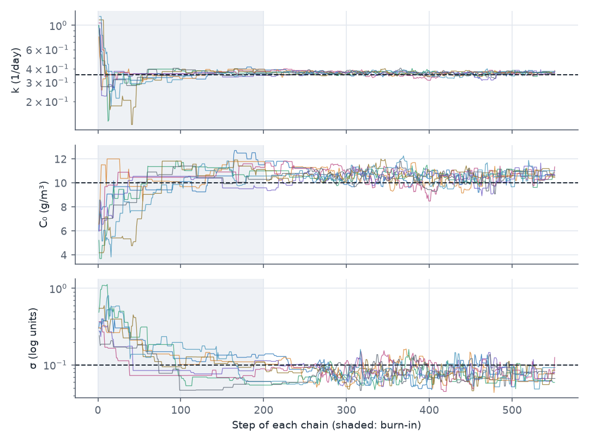
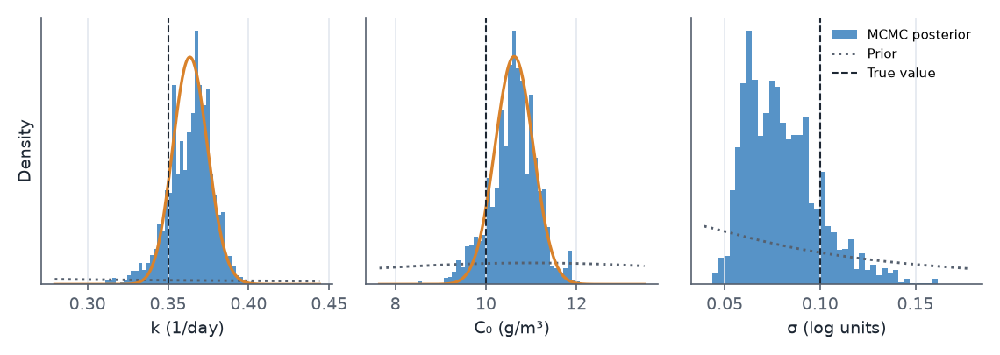
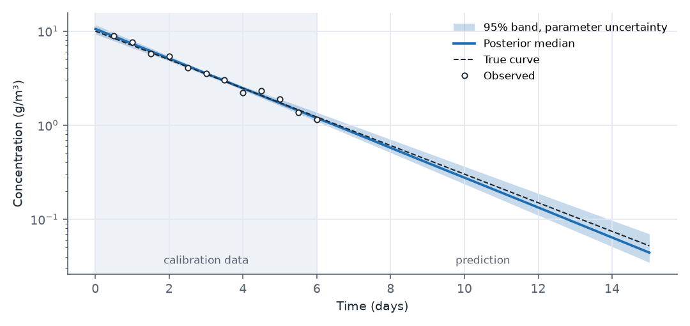

## What this model represents

A microcosm test measures how fast a contaminant degrades: a sample of water or slurry is sealed in a vessel and its concentration is measured over a few days. The result usually feeds a prediction, for example the time for a plume to fall below a cleanup level. A single best-fit rate constant hides how uncertain that prediction is. Bayesian calibration with **Markov chain Monte Carlo (MCMC)** gives the full joint distribution of the parameters given the data, and from it a range of predictions.

The model is deliberately simple: one closed reactor, one constituent, first-order decay. The "observed" data were made from the exact solution at known values (C₀ = 10 g/m³, k = 0.35 1/day) with 10% multiplicative noise, so the posterior can be checked against the truth. Twelve samples over six days is a typical laboratory record, and the question is what it says about the concentration after 15 days.

## How it works

### The model

The microcosm is a Reactor block of fixed volume V = 0.2 m³ with no flow. The reaction `Biodegradation` has rate k·C and stoichiometric coefficient −1, so

  d(V·C)/dt = −V·k·C,  C(0) = C₀

whose solution is C(t) = C₀·exp(−k·t). Three model quantities are calibrated through **Parameter** objects bound with `setasparameter`: `p_k` drives the `base_value` of the reaction parameter `k`, `p_C0` drives the initial `Contaminant:concentration` of the block, and `p_sigma` drives the observation's `error_standard_deviation`.

The solver step is held at 0.01 day (`max_timestep_increase_factor = 1`). With the default growth factor of 50 the step reaches 0.5 day, and the computed curve then differs from the exact solution by up to about 10% (at t = 1 day), which is larger than the measurement noise and would bias the estimates.

### Likelihood and priors

The observation uses `error_structure = log-normal`, so residuals are taken between log concentrations. With n = 12 points:

  −ln L = n·[ MSE/(2σ²) + ln σ ],  MSE = (1/n) Σ (ln oᵢ − ln mᵢ)²

This is the same likelihood that the genetic algorithm and Levenberg-Marquardt use. Because σ is a parameter here, its estimate is part of the posterior, and so is its uncertainty.

Each Parameter's `low` and `high` define its prior. For `normal` the prior is a normal distribution with mean (low + high)/2 and standard deviation (high − low)/4; for `log-normal` it is log-normal with geometric mean √(low·high) and log standard deviation ln(high/low)/4. In both cases `low` and `high` are the 2.5% and 97.5% points of the prior, not hard bounds. (The `uniform` prior, also available, is bounded.) The priors here are wide: for k they span three orders of magnitude.

### The sampler

OpenHydroQual runs several Metropolis-Hastings chains in parallel. Each step, every chain proposes a new parameter set from its current one, runs the model and accepts the proposal with probability min(1, p_new/p_old), where

  ln p = Σ ln prior(θᵢ) − (−ln L) + Σ_{log-normal i} ln θᵢ

The last term is the Hastings correction for proposals made in log space, which is how parameters with a `log-normal` prior are perturbed. A rejected proposal repeats the current state. Two proposal types are used in one run:

- **Diagonal (start of the run).** Each parameter is perturbed independently, by a normal step in log space for log-normal priors or in linear space otherwise. The step is `initual_purturbation_factor` (0.05) times the prior's range, and every 50 rounds it is divided by `purturbation_change_scale` (0.75) if the acceptance rate exceeded `acceptance_rate` (0.25) and multiplied by it otherwise.
- **Covariance-adapted.** Once `covariance_min_samples` (500) samples beyond the burn-in exist, the proposal becomes a correlated step drawn from the empirical covariance of the samples so far (in log space for log-normal parameters), scaled by 2.38/√d for d = 3 parameters. It is refreshed every `covariance_update_interval` (800) samples. This lets the chains move along the ridge where k and C₀ trade off.

The chains start from the Parameter `value` fields: the first chain exactly there, the others scattered around it (`initial_purturbation = Yes`). Sample counts are totals over all chains: `number_of_samples = 4800` with 8 chains is 600 steps per chain, and `number_of_burnout_samples = 1600` discards the first 200 steps of each chain.

After sampling, `number_of_post_estimate_realizations = 200` parameter sets are drawn at random from the post-burn-in samples and the model is run for each. The 2.5%, 50% and 97.5% points of these runs at each time form the prediction band. The realizations are model curves only; they show the effect of parameter uncertainty, not the scatter of a future measurement.

### Running

In the interface, press **MCMC parameter estimation**. Headless:

```
OHQ-MCMC batch_decay_mcmc.ohq results/
```

The run writes `mcmc.txt` (every recorded sample: index, parameters, log posterior), `posterior_percentiles.txt`, `Posterior_distributions.txt` (histogram densities), `Realizations_Concentration.txt` (one column per realization), `Predicted_95p_BracketConcentration.txt` (mean, 2.5%, 50% and 97.5% at each time), and a forward run at the posterior medians. The run below took 4.3 minutes on two threads. The settings in the file are kept small so that the example runs quickly. For a production run, increase `number_of_samples` to at least 5000 per chain (40 000 for 8 chains), keep the burn-in at 20 to 30%, use 500 or more realizations, and confirm that independent chains agree (for example with the Gelman-Rubin R̂ below 1.05).

## What to look for in the results



- **Burn-in.** The chains start at k ≈ 1 1/day and C₀ ≈ 6 g/m³, far from the data. Within about 50 steps k settles near 0.36; C₀ and σ take longer because the diagonal proposal moves them in small, often rejected steps. After step 263 the covariance-adapted proposal takes over and the chains mix visibly faster. The Gelman-Rubin R̂ of the post-burn-in samples is 1.01 for k and C₀ and 1.04 for σ, adequate for a demonstration but a sign that a longer run is needed for reported numbers.



| Parameter | Truth | Posterior median | 95% credible interval | LM estimate (95% interval) |
|---|---:|---:|---|---|
| k (1/day) | 0.35 | 0.366 | 0.333 to 0.388 | 0.364 (0.343 to 0.386) |
| C₀ (g/m³) | 10.0 | 10.62 | 9.50 to 11.68 | 10.62 (9.80 to 11.45) |
| σ (log units) | 0.10 | 0.077 | 0.053 to 0.129 | 0.064 (profiled) |

The credible intervals are computed from the 2816 post-burn-in samples in `mcmc.txt`. The LM column is a separate run of `OHQ-LM` on the same file.

- **The data dominate the priors.** The posteriors are narrow compared with the priors, which are nearly flat over the plotted range. All three intervals contain the true values.
- **MCMC and LM agree on k and C₀.** For this nearly linear problem (log C is linear in ln C₀ and k) the posterior is close to the Gaussian that LM derives from its Jacobian. The MCMC intervals are somewhat wider because they also account for the uncertainty in σ, which LM fixes at its best value.
- **σ is skewed.** With 12 points, the error standard deviation is poorly determined and its posterior has a long upper tail. Its median (0.077) lies above the maximum-likelihood value (0.064), which is biased low for small samples.
- **k and C₀ are correlated** (correlation 0.87 in the samples). A higher starting concentration can be offset by faster decay. Reporting the two marginal intervals separately understates how well their combination, the concentration within the measured period, is known.



- **The band widens outside the data.** At day 3 the 95% band spans a factor of 1.09 (3.39 to 3.71 g/m³). At day 15, nine days after the last sample, it spans a factor of 2.0 (0.035 to 0.070 g/m³), because the uncertainty in k is multiplied by t in the exponent. The true value at day 15 (0.052 g/m³) lies inside it.

## Assumptions and limitations

- The model is exact first-order decay in a closed, well-mixed vessel. Real microcosms can show lag phases, substrate limitation or sorption, which this model cannot represent; with real data the posterior describes the parameters of this model, not of the real system.
- The noise is independent and log-normal with a constant σ, and that is the error model assumed in the likelihood. Serially correlated errors from dense sensor records need the AR1 error model (see that example).
- The sampler adapts its step size throughout the run, including after burn-in. Strictly, an adaptive sampler only converges to the posterior when the adaptation dies out; with long runs the effect is small, but it is another reason to use long runs for reported results.
- The prediction band contains parameter uncertainty only. A band for a future measurement would also include the observation noise σ, which here is about ±15% (two standard deviations in log units).
- In this run `mcmc.txt` holds 4408 of the 4800 samples, because the file is written in blocks of 50 rounds and the last partial block was not written. `posterior_percentiles.txt` is computed from the samples held in memory and agrees with the table above to within sampling noise.
