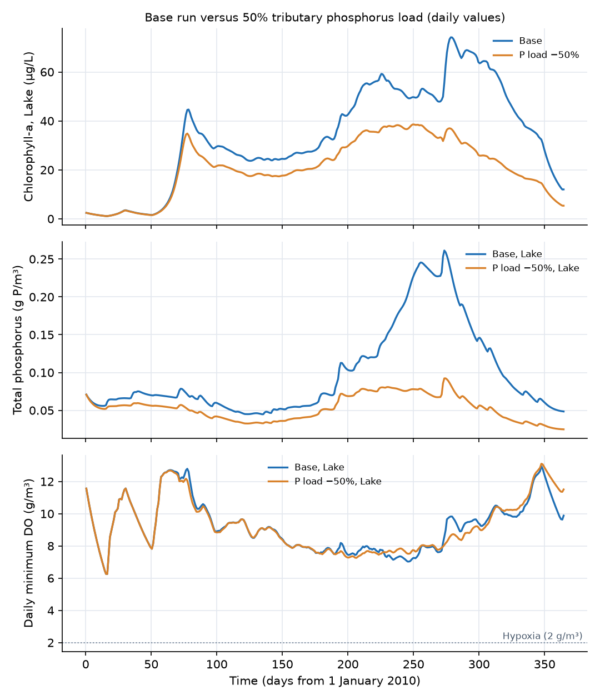

## What this model represents

Eutrophication is the over-enrichment of a lake with nutrients, mostly phosphorus and nitrogen, and the chain of consequences that follows: dense algal blooms, turbid water, large swings in dissolved oxygen and, in time, a sediment so loaded with phosphorus that it keeps feeding the algae after the external load is cut. Shallow lakes are especially prone to it. Wind keeps them mixed (polymictic), so the nutrients released from the bed reach the sunlit water at once.

This model is a 50 ha lake with a mean depth of 2.5 m over a phosphorus-rich sediment, run for the calendar year 2010 with hourly light, wind and air temperature from Baltimore/Washington International Airport (BWI). A synthetic tributary brings water and nutrients with storm pulses timed to the 2010 rainfall. The lake has a single phytoplankton group, the phosphorus cycle (phosphate, organic P and iron-bound P), an explicit nitrogen cycle (organic N, ammonia, nitrate and denitrification losses), detrital carbon, dissolved oxygen and the oxygen demand of reduced species. The sediment layer settles, decomposes and stores organic matter, and releases phosphate when it turns anoxic. A second model file, `shallow_lake_p_load_50pct.ohq`, halves the tributary phosphorus load so that the effect of a watershed load reduction can be compared with the base run.

The model is a teaching and screening tool. Its parameters are typical literature values and it has not been calibrated to any lake.

## How it works

**Blocks and links.** The `Lake` is a `Pond` block with S = α·d^β, β = 1 and α = 500 000 m², so its surface area is a constant 50 ha and its depth is d = S/α (about 2.53 m). The tributary enters through the Pond `inflow` series; each constituent enters at the concentration in its `time_variable_inflow_concentration` file, so the load is C_in(t)·Q_in(t). Water leaves over the `Outlet_weir`, Q = 2 940 000·max(h − 2.5, 0)^1.5 m³/day, which holds the level within 0.14 m of the crest. Under the lake, the `Sediment` block is a `Groundwater cell` 0.1 m thick with a porosity of 0.9, holding 45 000 m³ of pore water. It has no water flow. All its concentrations are per m³ of pore water: 1 g/m³ in the sediment is 0.09 g per m² of lake bottom.

**Transport between water and sediment.** On the `Sediment_interface` link, a constituent moves by

  J = Q·C_upstream + ((D·A + α_L·Q)/L + v_ex·A)·(C_Lake − C_Sediment)  (dissolved constituents)
  J = Q·C_upstream + v_s·A·C_Lake  (Particle constituents, settling from the higher block into the lower one)

with Q = 0 (no flow), A = 500 000 m² and D = α_L = 0. The exchange velocities are v_ex = 0.2 m/day for O2 and 0.02 m/day for PO4, NH3, NOx and ODU; the larger value for oxygen stands for the thin oxic surface layer, where most of the oxygen is consumed within millimetres of the interface. The settling velocities v_s are 0.05 m/day for algae, 0.25 m/day for POC, ON and OP and 0.3 m/day for PIP. Particles only settle down; resuspension is not represented, so these are net settling velocities. On the weir, all constituents leave with the water at the lake concentration.

**Reactions.** Thirteen reactions apply in every block (OpenHydroQual multiplies each rate, in g/m³/day, by the block volume and the stoichiometric coefficients). T is the block's `T_water`, I₀ its `PAR` and H its `depth`; θ^(T−20) corrects each rate for temperature.

| Reaction | Rate (g/m³/day) | Algae | POC | ON | OP | PIP | PO4 | NH3 | NOx | O2 | N2, ODU |
|---|---|---|---|---|---|---|---|---|---|---|---|
| Growth_on_NH3 | G·p_NH3 | +1 | | | | | −a_PC | −a_NC | | +r_OC | |
| Growth_on_NOx | G·(1 − p_NH3) | +1 | | | | | −a_PC | | −a_NC | +r_OC + r_ON·a_NC | |
| Algal_respiration | k_resp·θ_a^(T−20)·Algae·O2/(K_O + O2) | −1 | | | | | +a_PC | +a_NC | | −r_OC | |
| Algal_mortality | k_mort·θ_a^(T−20)·Algae | −1 | +1 | +a_NC | +a_PC | | | | | | |
| POC_aerobic_oxidation | k_C·θ_m^(T−20)·POC·O2/(K_O + O2) | | −1 | | | | | | | −r_OC | |
| Denitrification | k_C·θ_m^(T−20)·POC·K_O/(K_O + O2)·NOx/(K_NOx + NOx) | | −1 | | | | | | −a_dn | | N2 +a_dn |
| POC_anaerobic_oxidation | f_an·k_C·θ_m^(T−20)·POC·K_O/(K_O + O2)·K_NOx/(K_NOx + NOx) | | −1 | | | | | | | | ODU +r_OC |
| ODU_oxidation | k_odu·θ_m^(T−20)·ODU·O2/(K_O + O2) | | | | | | | | | −1 | ODU −1 |
| Ammonification | k_ON·θ_m^(T−20)·ON | | | −1 | | | | +1 | | | |
| OP_mineralization | k_OP·θ_m^(T−20)·OP | | | | −1 | | +1 | | | | |
| Nitrification | k_nit·θ_n^(T−20)·NH3·O2/(K_O_nit + O2) | | | | | | | −1 | +1 | −r_ON | |
| P_sorption | k_sorb·Fe_ox·PO4·O2/(K_Fe + O2) | | | | | +1 | −1 | | | | |
| P_release | k_rel·θ_m^(T−20)·PIP·K_Fe/(K_Fe + O2) | | | | | −1 | +1 | | | | |

**Algal growth.** The gross growth rate is

  G = μ_max·θ_g^(T−20)·f_L·f_N·f_P·Algae

with multiplicative Monod nutrient limitation on total inorganic nitrogen and on phosphate,

  f_N = (NH3 + NOx)/(K_N + NH3 + NOx),  f_P = PO4/(K_P + PO4)

and a light limitation that is the Monod light response averaged over the depth of the block, with Beer-Lambert attenuation:

  f_L = ln((K_I + I₀)/(K_I + I₀·e^(−k_e·H)))/(k_e·H),  k_e = k_bg + k_chl·chl_C·Algae

The extinction coefficient includes self-shading: at 80 µg/L of chlorophyll-a, k_e = 2.1 per m and 0.5% of the surface light reaches the bottom. Because I₀ is hourly, growth stops at night and peaks at midday. The ammonium preference factor of Thomann and Mueller splits the nitrogen uptake between NH3 and NOx:

  p_NH3 = NH3·NOx/((K_NH + NH3)(K_NH + NOx)) + NH3·K_NH/((NH3 + NOx)(K_NH + NOx))

It is 1 when only ammonia is present and 0 when only nitrate is. Algae have fixed Redfield stoichiometry (a_NC = 0.176 g N/g C, a_PC = 0.0244 g P/g C), and growth on nitrate releases more oxygen (3.47 g O₂/g C) than growth on ammonia (2.67), because the nitrate is reduced inside the cell.

**Organic matter, nitrogen and phosphorus cycles.** Dead algae become detritus with separate carbon (POC), nitrogen (ON) and phosphorus (OP) pools, which settle together. The tributary brings its own POC, ON and OP. Organic N is ammonified to NH3 and organic P mineralized to PO4 by first-order kinetics, independent of oxygen. Detrital carbon is oxidized by three pathways in sequence: with oxygen (consuming 2.67 g O₂/g C), with nitrate when oxygen is scarce (denitrification, removing 0.933 g N/g C as N2) and, when both are scarce, by other electron acceptors at 30% of the aerobic rate. The reduced products of this last pathway are carried as oxygen demand units (ODU, 2.67 g O₂-eq per g C, after Di Toro 2001); they diffuse out of the sediment like other solutes and are reoxidized by oxygen wherever it is available, so the oxygen demand of carbon mineralized anaerobically is not lost. Ammonia is nitrified to nitrate when oxygen is present (4.57 g O₂/g N). The same reactions run in the sediment, where the settled detritus is concentrated: the oxygen they consume there, supplied across the interface, is the sediment oxygen demand, and the nitrate the sediment removes (by direct uptake from the water and by coupled nitrification and denitrification) is the main nitrogen sink.

**Redox-controlled phosphorus release.** The sediment holds phosphate bound to iron(III) oxides (PIP). While the pore water has oxygen, phosphate is sorbed to the oxides at a rate proportional to the iron content (`Fe_ox`, 5000 g Fe/m³, which exists only in the sediment). When the pore water loses its oxygen, the iron is reduced and the bound phosphate dissolves at a rate k_rel·θ_m^(T−20)·PIP·K_Fe/(K_Fe + O2). Pore-water phosphate then diffuses into the lake. This is the classic Mortimer mechanism of internal loading: release is fast when the sediment is warm and anoxic and slow when it is cold and oxic. In the water column, where Fe_ox is zero, PIP from the tributary can also dissolve if the water turns anoxic, but no phosphate is sorbed.

**Reaeration.** The `Reaeration` source (Banks-Herrera) adds oxygen to the lake at

  F = A·K_L·1.024^(T−20)·(DO_sat − O2),  K_L = 0.728·U^0.5 − 0.317·U + 0.0372·U²  (m/day)
  DO_sat = 14.652 − 0.41022·T + 0.007991·T² − 0.000077774·T³

with A = 500 000 m² (the pond area), U the hourly wind speed at 10 m (BWI, converted from mph) and T the water temperature. Over the open-water season U averages 3.9 m/s and K_L averages 0.86 m/day (0.71 m/day over the whole year including ice, 0.73 m/day in July), within the 0.5 to 3 m/day usual for lakes; at 10 m/s K_L is 2.9 m/day. For the 2.53 m deep lake this is a volumetric rate K_L/H of about 0.3 per day. When the lake is supersaturated the flux is negative and oxygen escapes to the air.

**Forcing.** Air temperature, shortwave radiation and wind speed are the hourly NOAA Local Climatological Data for BWI in 2010, rebased to day 0 = 1 January 2010 00:00 (Excel serial date 40179). The first air-temperature record reads 22 °C between readings of 2.2 °C and was corrected to 2.2 °C; 16 records flagged as suspect ("s") were dropped. Water temperature is an exponential moving average of the hourly air temperature with a 5-day time constant (dT_w/dt = (T_air − T_w)/5 days), floored at 1 °C. The lake is taken as ice-covered whenever the water temperature is below 1.5 °C (52 days: 1 to 17 January, 31 January to 20 February and 14 to 29 December, during the cold, snowy winter of 2010). Under ice the PAR is reduced to 10% and the wind to zero, which turns off reaeration. PAR is 0.45 times the shortwave radiation. The inflow and its concentrations are synthetic (see Input files).

**Parameter values.** Not calibrated. Values are typical of the ranges in Chapra (1997), Bowie et al. (1985) and the WASP and CE-QUAL-W2 manuals.

| Parameter | Value | Unit | Typical range |
|---|---|---|---|
| μ_max, θ_g | 2.5, 1.066 | 1/day, - | 1 to 3; 1.02 to 1.07 |
| K_I | 30 | W/m² PAR | 10 to 60 |
| K_N, K_P, K_NH | 0.03, 0.005, 0.025 | g/m³ | 0.01 to 0.1; 0.001 to 0.02; 0.01 to 0.05 |
| k_bg, k_chl | 0.8, 0.016 | 1/m, m²/mg chl | 0.2 to 2; 0.01 to 0.02 |
| chl_C | 25 | mg chl/g C | 10 to 50 (C:chl 20 to 100) |
| a_NC, a_PC | 0.176, 0.0244 | g/g C | Redfield |
| k_resp, k_mort, θ_a | 0.15, 0.12, 1.08 | 1/day, 1/day, - | 0.05 to 0.2; 0.02 to 0.2; 1.04 to 1.08 |
| k_C, k_ON, k_OP, θ_m | 0.1, 0.05, 0.07, 1.08 | 1/day, - | 0.01 to 0.2; 1.02 to 1.10 |
| k_odu | 1.0 | 1/day | 0.1 to 10 (sulfide and Fe²⁺ oxidation) |
| K_O, K_NOx, f_an | 0.5, 0.1, 0.3 | g/m³, g N/m³, - | 0.1 to 1; 0.05 to 0.5 |
| k_nit, θ_n, K_O_nit | 0.1, 1.08, 1.0 | 1/day, -, g/m³ | 0.05 to 0.5; 1.05 to 1.08; 0.5 to 2 |
| k_sorb·Fe_ox, K_Fe, k_rel | 0.5, 1.0, 0.012 | 1/day, g/m³, 1/day | model-specific |
| v_s algae, detritus, PIP | 0.05, 0.25, 0.3 | m/day | 0.05 to 0.5; 0.1 to 1; 0.1 to 1 (net of resuspension) |
| v_ex O2, solutes | 0.2, 0.02 | m/day | model-specific |

**Simulation settings.** The run covers day 0 to 365 with an initial step of 0.01 day and `max_timestep_increase_factor` = 4, so the step never exceeds 0.04 day (about one hour); this keeps the fast, nonlinear kinetics and the diurnal light cycle accurate. A run takes about 1 to 2 minutes.

## What to look for in the results

- **Seasonal succession.** Under ice (January and February) light is too low for growth and chlorophyll-a falls below 3 µg/L. After ice-out a spring bloom reaches about 47 µg/L in mid-March, limited by phosphorus: phosphate is drawn down from 0.06 to 0.003 g P/m³, where f_P = 0.4. In July and August chlorophyll-a is 50 to 65 µg/L, and it peaks at 79 µg/L on 6 October. The May to September mean is 40 µg/L, which places the lake in the eutrophic to hypereutrophic range.
- **From phosphorus to nitrogen limitation.** Nitrate is 1.5 g N/m³ in spring. By mid-August it has been exhausted (below 0.01 g N/m³) by algal uptake and denitrification, while sediment phosphate release lifts PO4 to 0.15 g P/m³. The algae are then nitrogen limited, the classic late-summer shift in eutrophic lakes in which nitrogen-fixing cyanobacteria (not represented here) gain an advantage. Total N falls from 2.0 g N/m³ in April and May to 0.78 g N/m³ in August.
- **The October rise in chlorophyll-a.** The 118 mm storm of 30 September and its recession bring about 540 kg of nitrate and ammonia in five days into a lake that is nitrogen limited but holds 0.14 g P/m³ of phosphate. Lake NOx rises from 0.005 to 0.14 g N/m³ in two days, and the algae, no longer nitrogen limited, grow from a daily mean of 48 to 74 µg/L over the next six days (net 0.07 per day, with gross growth of about 0.5 per day in daylight). The storm water, free of algae, replaces about a quarter of the lake volume in three days, so dilution and washout do act, but growth outpaces them once the nitrogen arrives. The rise looks sudden only on the scale of a year.
- **Diel oxygen cycle.** In July the pre-dawn minimum (7.4 to 8.2 g/m³) is on average equal to saturation (7.4 to 8.0 g/m³) and falls below it on 11 of 31 nights; the afternoon maximum is about 115% of saturation. In August the minimum is below saturation on 25 of 31 nights (by 0.37 g/m³ on average) and in September on every night (by 0.65 g/m³). The lowest summer DO is 7.0 g/m³ before dawn on 4 September. The wind-mixed shallow lake never becomes hypoxic.
- **Oxygen budget.** Over the year the water column produces 152 t more oxygen by photosynthesis than it consumes by respiration, decomposition, nitrification and ODU oxidation, the sediment takes up 166 t, and the lake gains a net 10.5 t from the atmosphere: the lake as a whole is slightly net heterotrophic, fed by the organic carbon of the tributary and the sediment.
- **Winter oxygen depletion.** Under ice there is no reaeration and little photosynthesis, so sediment and water respiration pull DO from 12 to 6.3 g/m³ in January, 7.8 g/m³ in February and 9.6 g/m³ in December, while saturation is 14 g/m³.
- **Internal phosphorus loading.** Sediment pore-water oxygen falls below 1.5 g/m³ from 10 August to 27 September, and the phosphate release rises to 20 to 31 mg P/m²/day, against 1 to 5 mg P/m²/day in winter. Over the year the sediment releases 1370 kg of P (2.7 g P/m²), 1.5 times the tributary load of 898 kg. Because the sediment is oxic for most of the year, it also traps phosphate as iron-bound P, which grows from 40 to 52 g P/m³ of pore water over the year.
- **Sediment oxygen demand.** The sediment takes up 0.45 to 0.9 g O₂/m²/day in winter and 1.3 to 1.4 g O₂/m²/day in August and September, 166 t over the year.
- **Phosphorus budget.** Inflow 898 kg; outflow 461 kg; net retention 437 kg (49%), stored as iron-bound P in the sediment. Inflow minus outflow equals the change in storage to better than 0.01 kg.
- **Nitrogen budget.** Inflow 11 830 kg; outflow 6 870 kg (58%); denitrification 4 950 kg (42%: 3 690 kg in the sediment and 1 260 kg in the water); the N stored in the lake and the sediment is unchanged to within 5 kg. The budget closes to 0.02 kg.
- **Halving the phosphorus load.** With the tributary P load cut from 898 to 449 kg, the mean total phosphorus of the lake falls by 46% (0.098 to 0.053 g P/m³), chlorophyll-a falls by 30% in May to September (40 to 28 µg/L) and the October peak by half (79 to 42 µg/L), because the lake no longer holds enough phosphate to use the storm nitrate. Sediment release falls from 1370 to 860 kg, so internal loading still delivers twice the external load. The sediment buffers the response; a full recovery takes years, as its phosphorus pool is depleted.

The comparison figure was made with `results/compare_scenarios.py` from the output files of the two models. The forcing files and both model files were generated by `results/prep.py` (from the BWI records) and `results/gen.py`; the model files are plain text and can also be edited directly.

## Assumptions and limitations

- The lake is a single well-mixed box. Temperature stratification on calm days, spatial patchiness, and the littoral zone with macrophytes are not represented. The Stratified Lake Eutrophication example adds two layers.
- Water temperature is derived from air temperature by a smoothing filter, not from a heat budget. Ice cover is inferred from the 1 °C floor of that filter and its effect is reduced to a fixed light transmission and zero wind.
- One phytoplankton group with fixed stoichiometry and fixed chlorophyll to carbon ratio. Nitrogen fixation, cyanobacterial buoyancy, zooplankton grazing dynamics (lumped into mortality), silica limitation and luxury phosphorus uptake are not modeled.
- Settling is net settling; wind-driven resuspension of sediment, important in shallow lakes, is not represented.
- The sediment is one 0.1 m layer with a single oxygen concentration. The redox switch of iron-bound phosphorus is driven by the mean pore-water oxygen, which stands in for the thin oxic surface layer of real sediments. The fixed iron pool is not consumed, sulfide does not bind iron, and there is no burial of phosphorus below 0.1 m.
- Reduced species are lumped into one ODU pool that is reoxidized at a single rate; methane escaping as bubbles, iron sulfide burial and the different kinetics of Fe²⁺, Mn²⁺ and H₂S are not represented.
- The Monod inhibition terms let a small fraction of denitrification proceed in oxic water (about 6% of the aerobic rate at 8 g/m³ of O2), which stands for denitrification in anoxic microsites of settling particles.
- The tributary flow and concentrations are synthetic; storm timing follows the 2010 BWI rainfall, but magnitudes are not those of a real stream. Precipitation on and evaporation from the lake surface are not included.
- Parameters are literature values and have not been calibrated. The initial sediment phosphorus (3.6 g P/m² of iron-bound P) sets the strength of the internal loading and is the most influential uncertain input.
- The constituents also enter the Outlet boundary and the reactions run there, but nothing in the Outlet affects the lake.

**Data credit.** Air temperature, solar radiation, wind speed and rainfall: NOAA National Centers for Environmental Information (formerly NCDC), Local Climatological Data, Baltimore/Washington International Airport, Maryland, 2010. US public domain.
