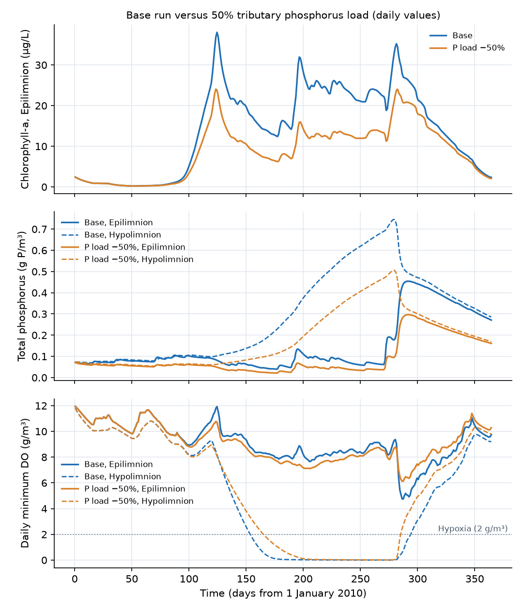

## What this model represents

In a lake deep enough to stratify, summer warming creates a warm, light surface layer (the **epilimnion**) floating on cold, dense bottom water (the **hypolimnion**). The density step between them, the **thermocline**, suppresses vertical mixing. The hypolimnion is then cut off from the atmosphere for months while organic matter from the productive surface rains down into it and onto the sediment. In a eutrophic lake its oxygen is used up, the sediment turns anoxic, iron-bound phosphorus dissolves, and phosphate and ammonia accumulate in the bottom water. In autumn the surface cools until the layers have the same density, and wind mixes the whole lake (**turnover**). The nutrient-rich, oxygen-free bottom water then mixes into the surface, which can cause an oxygen sag and a late bloom.

This model is the [Shallow Lake Eutrophication](../shallow-lake-eutrophication/) model rebuilt as a two-layer lake with a maximum depth of 12 m: a 4 m epilimnion over 50 ha and an 8 m hypolimnion over 30 ha, with the sediment under the hypolimnion. It uses the same biogeochemistry (phytoplankton, explicit nitrogen and phosphorus cycles, detritus, dissolved oxygen and redox-controlled phosphorus release), the same 2010 BWI weather, and tributary concentrations identical to the shallow lake. The second model file, `stratified_lake_p_load_50pct.ohq`, halves the tributary phosphorus load. The parameters are literature values; nothing is calibrated.

## How it works

**Layers.** Both layers are vertical-walled `Pond` blocks (S = α·d, area α): the `Epilimnion` (α = 500 000 m², bottom at 8 m) and the `Hypolimnion` (α = 300 000 m², bottom at 0 m, 8 m deep). The tributary enters the epilimnion, and the epilimnion spills over the `Outlet_weir`, Q = 2 940 000·max(h − 12, 0)^1.5 m³/day. The hypolimnion has no net flow. The `Sediment` block, a 0.1 m layer with 0.9 porosity, lies under the hypolimnion only. The sloping sides of a real lake bottom are lumped: all particles that leave the epilimnion settle into the hypolimnion (sediment focusing), and the sediment under the epilimnion is not represented.

**Vertical mixing.** The layers exchange water through two `Time-Dependent flow` links with the same flow Q_mix(t), one down and one up. Every constituent therefore moves by Q_mix·(C_epi − C_hypo) with no change in volume, which is the bulk form of vertical turbulent diffusion, Q_mix = A·K_z/Δz, with A = 300 000 m² the thermocline area and Δz = 6 m the distance between the layer centres. K_z is 10 m²/day (1.2 × 10⁻⁴ m²/s) while the lake is mixed and 0.1 m²/day (1.2 × 10⁻⁶ m²/s, a typical thermocline value) while it is stratified. Particles also settle from the epilimnion into the hypolimnion across the full 50 ha (`Exchange_down` carries the area; `Exchange_up` has a negligible area so settling is counted once), and from the hypolimnion into the sediment across 30 ha.

**Stratification timing and the hypolimnion temperature.** Both are derived from the epilimnion temperature series and written to input files:

- *Onset*: the first day after 1 April from which the 7-day mean epilimnion temperature stays at or above 16 °C for 22 days. In 2010 a warm spell in early April is followed by a cooler spell, and the criterion places the onset on 1 May (day 120).
- *During stratification*: the hypolimnion gains heat only through the weak exchange, dT_h/dt = Q_mix/V_h·(T_e − T_h), with Q_mix = 5000 m³/day and V_h = 2.4 million m³, a time constant of 480 days. It warms from 15.3 to 18.0 °C.
- *Turnover*: the first day, at least 60 days after onset, on which the epilimnion has cooled to within 0.5 °C of the hypolimnion: 5 October (day 278). After it, T_h = T_e.
- K_z changes log-linearly over 5 days at onset and at turnover.

**Light.** The epilimnion receives the surface PAR. The hypolimnion receives PAR × exp(−1.2·4) = 0.8% of it, the light left below the epilimnion, and the sediment is dark. Within each layer, algal growth uses the depth-averaged light limitation with the layer's own depth and self-shading, so the hypolimnion grows practically no algae.

**Reactions.** The thirteen reactions, their rates, stoichiometry and parameter values are exactly those of the shallow-lake example (see its documentation for the full table). In brief, with T, I₀ and H the block's temperature, top-of-layer PAR and depth:

  G = μ_max·θ_g^(T−20)·f_L·f_N·f_P·Algae
  f_L = ln((K_I + I₀)/(K_I + I₀·e^(−k_e·H)))/(k_e·H),  k_e = k_bg + k_chl·chl_C·Algae
  f_N = (NH3 + NOx)/(K_N + NH3 + NOx),  f_P = PO4/(K_P + PO4)

split between ammonium and nitrate uptake by the preference factor p_NH3 = NH3·NOx/((K_NH + NH3)(K_NH + NOx)) + NH3·K_NH/((NH3 + NOx)(K_NH + NOx)). Algae respire (k_resp·θ_a^(T−20)·Algae·O2/(K_O + O2)) and die into POC, ON and OP (k_mort·θ_a^(T−20)·Algae) with Redfield ratios. POC is oxidized aerobically (k_C·θ_m^(T−20)·POC·O2/(K_O + O2), 2.67 g O₂/g C), by denitrification when oxygen is low (k_C·θ_m^(T−20)·POC·K_O/(K_O + O2)·NOx/(K_NOx + NOx), 0.933 g N/g C lost as N2) and by other acceptors when both are low (f_an = 0.3 times the aerobic rate), producing oxygen demand units (ODU, 2.67 g O₂-eq/g C) that are reoxidized by oxygen at k_odu·θ_m^(T−20)·ODU·O2/(K_O + O2). ON is ammonified (k_ON·θ_m^(T−20)·ON) and OP mineralized (k_OP·θ_m^(T−20)·OP). Ammonia is nitrified (k_nit·θ_n^(T−20)·NH3·O2/(K_O_nit + O2), 4.57 g O₂/g N). In the sediment, phosphate is sorbed to iron oxide while oxygen is present (k_sorb·Fe_ox·PO4·O2/(K_Fe + O2)) and released when it is not (k_rel·θ_m^(T−20)·PIP·K_Fe/(K_Fe + O2)). Each rate is temperature corrected with the block's own temperature, so decomposition in the 16 °C hypolimnion runs at 74% of its rate at the 20 °C reference and at 40% of its rate in the 28 °C epilimnion.

**Reaeration.** Only the epilimnion exchanges oxygen with the air:

  F = A·(0.728·U^0.5 − 0.317·U + 0.0372·U²)·1.024^(T−20)·(DO_sat − O2),  DO_sat = 14.652 − 0.41022·T + 0.007991·T² − 0.000077774·T³

with A = 500 000 m², U the hourly wind speed at 10 m (zero under ice) and T the epilimnion temperature.

**Forcing.** As in the shallow-lake example: BWI 2010 hourly air temperature (first record corrected from 22 to 2.2 °C, 16 suspect records dropped), shortwave radiation and wind speed, rebased to day 0 = 1 January 2010; water temperature from a 5-day exponential moving average of air temperature with a 1 °C floor; ice cover (10% light, no wind) while the water is below 1.5 °C. The tributary is synthetic, with the same concentrations as the shallow lake and a flow scaled up 3.5 times so that the residence time is again 100 days.

**Simulation settings.** Day 0 to 365, initial step 0.01 day, `max_timestep_increase_factor` = 4 (steps of at most 0.04 day). A run takes 1 to 2 minutes.

## What to look for in the results

- **Hypolimnetic oxygen depletion.** At the onset of stratification the hypolimnion holds 9.3 g/m³ of oxygen. It falls below 2 g/m³ on 3 June (day 154) and below 0.5 g/m³ on 15 June, an areal depletion rate of about 1.8 g O₂/m²/day over the 8 m layer. It stays hypoxic until 21 October (140 days with a daily minimum below 2 g/m³) and reaches 0.002 g/m³ just before turnover. Once the bottom water is anoxic, sediment oxygen uptake falls from 0.4 to about 0.01 g O₂/m²/day, and the reduced products of anaerobic decomposition accumulate instead: hypolimnion ODU reaches 5.6 g O₂-eq/m³ at turnover.
- **Sediment phosphorus release and accumulation below the thermocline.** The anoxic sediment releases 26 to 40 mg P/m²/day from June to September, 1230 kg over the stratified period, and its iron-bound P pool falls from 53 to 25 g P/m³. With the thermocline nearly closed, the phosphate stays in the hypolimnion, where PO4 rises from 0.07 to 0.68 g P/m³ and total P to 0.75 g P/m³. Only 230 kg of phosphate leaks up into the epilimnion during stratification.
- **Nitrogen below the thermocline.** Hypolimnion nitrate is denitrified from 2.0 to 0.002 g N/m³ by late September and ammonia accumulates to 1.6 g N/m³. Over the year the water and sediment denitrify 11 650 kg of N (7050 kg in the hypolimnion, 1780 kg in the sediment and 2820 kg in the oxic epilimnion, where the leaky Monod inhibition stands for denitrification in anoxic microsites of particles), 28% of the 41 400 kg N input.
- **Epilimnion.** The spring bloom peaks at 41 µg/L of chlorophyll-a on 5 May. In summer the surface layer is phosphorus limited (PO4 0.002 to 0.008 g P/m³) and chlorophyll-a stays at 15 to 30 µg/L, May to September mean 22 µg/L. Nitrate remains above 0.57 g N/m³ all year, so unlike the shallow lake, this lake does not become nitrogen limited: the denitrification and the ammonia accumulation happen out of reach of the algae.
- **Epilimnion oxygen.** From June to September the epilimnion stays above saturation day and night: in July the pre-dawn minimum is 7.7 to 8.9 g/m³ against a saturation of 7.4 to 8.0 g/m³ (0.4 g/m³ above it on average) and the afternoon maximum about 113% of saturation, with a daily swing of only 0.3 to 0.8 g/m³ in the 4 m layer. This is the expected metabolic separation of a stratified productive lake: the epilimnion is net autotrophic because much of the organic matter it produces settles into the hypolimnion before it decomposes, and because algae growing on nitrate release an extra 0.8 g O₂ per g C (a photosynthetic quotient of 1.3) whose counterpart, the denitrification of the exported nitrogen, takes place below the thermocline. The oxygen deficit is moved to the hypolimnion, which consumes it in full.
- **Fall turnover.** From 5 October the layers mix. Epilimnion phosphate jumps from 0.009 to 0.36 g P/m³ (total P 0.45 g P/m³) within about three weeks, 1040 kg of phosphate are mixed up into the surface layer, and a short fall bloom reaches 38 µg/L. The anoxic water, with the ammonia and reduced species it carries, pulls epilimnion oxygen down to 4.7 g/m³ (50% of saturation) on 15 October, against more than 9 g/m³ before turnover. After turnover the reoxygenated sediment sorbs phosphate again (negative flux).
- **Oxygen budget.** Over the year the water column (both layers) consumes 29 t more oxygen than it produces, the sediment takes up 45 t and returns 14 t as ODU, and the lake gains a net 53 t from the atmosphere: on the whole, a net heterotrophic lake.
- **Phosphorus budget.** Inflow 3144 kg; outflow 2433 kg; increase in storage 711 kg, of which 936 kg as phosphate in the water (the turnover pulse that has not yet been flushed by 31 December), offset by losses of 143 kg of iron-bound P from the sediment and 94 kg of organic P from the water and the sediment. The budget closes to 0.03 kg.
- **Nitrogen budget.** Inflow 41 400 kg; outflow 27 740 kg (67%); denitrification 11 650 kg (28%); increase in storage 2000 kg, mostly nitrate left in the lake at the end of the year. The budget closes to 0.2 kg.
- **Halving the phosphorus load.** With the tributary P load cut from 3144 to 1572 kg, the May to September mean chlorophyll-a in the epilimnion falls by 46% (22 to 12 µg/L) and the annual peak from 41 to 26 µg/L. The epilimnion is phosphorus limited, so it responds strongly. The hypolimnion responds much less: its peak total P falls from 0.75 to 0.51 g P/m³, sediment release from 1600 to 1130 kg, and the number of hypoxic days only from 140 to 120. The oxygen sag at turnover is milder (6.1 against 4.7 g/m³). Hypolimnetic anoxia is sustained by the organic matter and the phosphorus already stored in the sediment, and it disappears only after years of reduced loading.

The figure was made with `results/compare_scenarios.py` from the output files of both models. The forcing files (including the derived hypolimnion temperature and vertical exchange) and both model files were generated by `results/prep.py` and `results/gen.py`; the model files are plain text and can also be edited directly.

## Assumptions and limitations

- Two fully mixed layers with fixed volumes. The thermocline does not deepen through the summer, there is no metalimnion, and the hypsometry is reduced to two areas (50 ha and 30 ha). Sediment under the epilimnion is not represented; all particles leaving the surface layer settle into the hypolimnion.
- Stratification is prescribed through the vertical exchange series and the hypolimnion temperature series, both derived from the epilimnion temperature by simple, documented rules. No heat budget, wind-driven mixing or density calculation is solved. Short mixing events during stratification and the partial mixing of spring are not represented; the lake behaves as warm monomictic (no winter stratification under ice).
- The epilimnion temperature is a smoothed air temperature, the same as for the shallow lake. Ice cover is inferred from it.
- The hypolimnion light is a fixed fraction of the surface light; it does not respond to the algal shading in the epilimnion.
- All biogeochemical assumptions of the shallow-lake example apply: one algal group with fixed stoichiometry, no nitrogen fixation, net settling without resuspension, a single 0.1 m sediment layer, a fixed iron pool, and reduced species lumped into one ODU pool (no methane ebullition, no iron sulfide burial).
- The tributary is synthetic and the parameters are uncalibrated literature values. The initial sediment phosphorus pool controls the strength of the internal load.

**Data credit.** Air temperature, solar radiation, wind speed and rainfall: NOAA National Centers for Environmental Information (formerly NCDC), Local Climatological Data, Baltimore/Washington International Airport, Maryland, 2010. US public domain.
