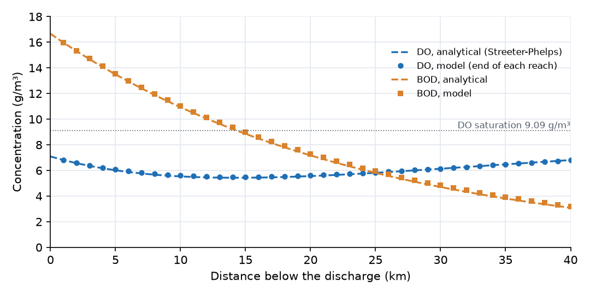

## What this model represents

A wastewater treatment plant discharges into a river. Just below the outfall the effluent and the river water are fully mixed: the mixture carries 16.66 g/m³ of ultimate BOD and 7.09 g/m³ of dissolved oxygen, against a saturation value of 9.09 g/m³. As the water travels downstream, bacteria oxidize the BOD and draw down the oxygen, while oxygen enters from the atmosphere at a rate proportional to the deficit. Early on, consumption wins and DO falls; further downstream the BOD is depleted, reaeration wins and DO recovers. The low point is the **critical point**, and its DO is what water-quality standards are checked against.

Streeter and Phelps (1925) solved this problem analytically for steady, plug-flow conditions. This model solves the same processes with OpenHydroQual's channel hydraulics and reaction engine, and the README compares the two. The same setup can be extended to what the analytical solution cannot handle: varying flow, several outfalls, tributaries, or temperature-dependent rates.

## How it works

**Hydraulics.** Each reach is a `Trapezoidal Channel Segment`. Its depth follows from its stored volume S and length ℓ:

  depth = (−b + √(b² + 4·z·S/ℓ)) / (2·z)

with base width b = 10 m and side slope z = 2. The links between reaches compute Manning flow from the water-surface slope:

  Q = (1/n) · A · R^(2/3) · sqt((h_up − h_down)/ℓ)

where A is the cross-sectional area of the upstream reach, R = A/P is the hydraulic radius using the mean wetted perimeter of the two reaches, and h is the water-surface elevation. OpenHydroQual's `_sqt` is a regularized square root, sqt(x) = √(x²/(|x| + 0.0001)), which keeps the derivative finite as the slope approaches zero. At this river's slope of 0.0002 it returns 82% of the exact square root, so the flowing depth is 1.39 m (the unregularized Manning equation would give 1.24 m). At 6.25 m³/s the mean velocity is U = 0.351 m/s, or 30.3 km/day, and water takes 1.3 days to travel the 40 km.

**Water quality.** Three reactions act in every reach. OpenHydroQual multiplies each rate by the reach volume and by the stoichiometric coefficients:

| Reaction | Rate | ν for BOD | ν for DO |
|---|---|---|---|
| BOD_oxidation | k_d·BOD | −1 | −1 |
| BOD_settling | k_s·BOD | −1 | 0 |
| Reaeration | k_a·(DO_sat − DO) | 0 | +1 |

so that in each reach

  d(V·BOD)/dt = Q·(BOD_in − BOD) − V·(k_d + k_s)·BOD
  d(V·DO)/dt = Q·(DO_in − DO) − V·k_d·BOD + V·k_a·(DO_sat − DO)

with k_d = 0.764, k_s = 0.514 and k_a = 1.902 per day. Reaeration is written as a reaction here; the `atmospheric exchange` source in the mass_transfer plugin computes the same flux, Storage·k·(saturation − concentration). The rates are fixed at their 20 °C values. The reaeration constant is an input; for reference, the O'Connor-Dobbins formula 3.93·U^0.5/H^1.5 (U in m/s, H in m) gives 1.4 per day for this depth and velocity.

**Analytical solution.** For steady plug flow the travel time to distance x is t = x/U. With k_r = k_d + k_s = 1.278 per day for total BOD removal and D = DO_sat − DO the oxygen deficit:

  BOD(t) = L₀ · e^(−k_r·t)
  D(t) = k_d·L₀/(k_a − k_r) · (e^(−k_r·t) − e^(−k_a·t)) + D₀ · e^(−k_a·t)

with L₀ = 16.66 g/m³ and D₀ = 9.092 − 7.09 = 2.00 g/m³. The deficit is largest at

  t_c = 1/(k_a − k_r) · ln[ (k_a/k_r) · (1 − D₀·(k_a − k_r)/(k_d·L₀)) ] = 0.472 day

which is 14.3 km downstream, where the analytical DO is 5.43 g/m³.

## What to look for in the results

- **Sag profile.** The figure below shows the steady state at day 3, with the model value at the downstream end of each reach and the analytical curves. DO falls from 7.09 g/m³ at the outfall to a minimum of 5.50 g/m³ in Reach_15 (14 to 15 km), then recovers to 6.8 g/m³ at 40 km.

- **Agreement.** The model DO is 0.06 g/m³ above the analytical value at 5 and 15 km and 0.01 g/m³ above it at 30 km. BOD is 0.4% to 2.6% higher. The differences come from representing the river as 40 well-mixed reaches: each 1 km reach behaves like a small continuously stirred tank, which slightly slows the first-order decay compared with plug flow and smooths the profile. Shorter reaches reduce the difference.
- **Settling matters.** Settling removes 40% of the BOD (k_s/k_r = 0.514/1.278) without consuming oxygen in the water column. With the same total removal but all of it as oxidation (k_d = 1.278 per day), the sag would be much deeper.
- **Travel time.** In the time-series plots each location responds after the water from the outfall reaches it, then levels off at its steady value. The 30 km location reaches steady state after about 1.6 days.

## Assumptions and limitations

- Flow, effluent load and temperature are constant. The model reaches steady state within 2 days; it can be driven with time-varying flow or concentrations by replacing the input files.
- The effluent is fully mixed with the river at the outfall. Lateral and vertical gradients are ignored.
- Only carbonaceous BOD is modeled. Nitrogenous oxygen demand (nitrification), sediment oxygen demand, photosynthesis and respiration are not included.
- Rate constants are constant along the river and not corrected for temperature. To add temperature dependence, link each reaction parameter to a temperature time series and set its Arrhenius factor (typically θ = 1.047 for k_d and 1.024 for k_a).
- Longitudinal dispersion is not specified (dispersivity 0); the reach-to-reach mixing of the 1 km cells acts as numerical dispersion.
- The input values (flow, mixed concentrations and rate constants) are illustrative and do not describe a particular river.
